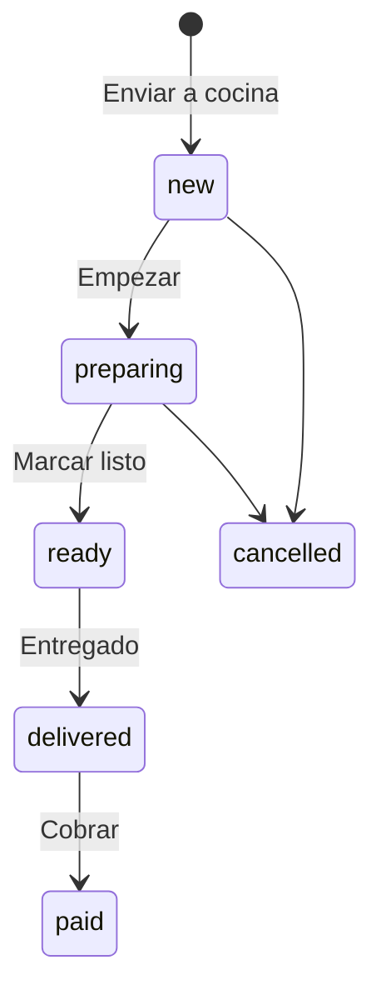

# BIGGER Ágil · Arquitectura (Fase 1)

Sistema a medida para la cafetería-pastelería BIGGER (Curicó). Este documento fija el modelo
de datos, los contratos y la estructura sobre la que se construyen las fases siguientes.
Contrato de API: [`docs/api/openapi.yaml`](api/openapi.yaml).

## 1. Alcance del MVP

| Módulo                        | Estado        | Incremento  |
| ----------------------------- | ------------- | ----------- |
| Mesas y comandas (+ WhatsApp) | Activo        | INC-3       |
| Carta digital y catálogo      | Activo        | INC-3/4     |
| Configuración de la carta     | Activo        | INC-4       |
| Vista de cocina               | Activo        | INC-3       |
| Bodega                        | En desarrollo | INC-4       |
| Compras                       | En desarrollo | INC-4       |
| Reportes                      | En desarrollo | INC-5       |
| Clientes (cuentas semanales)  | En desarrollo | Por definir |

Los módulos en desarrollo aparecen en la navegación y muestran la pantalla «En desarrollo».
Para habilitar uno basta con cambiar su entrada en `apps/web/src/app/navigation.ts` a
`status: 'active'` y registrar su ruta.

## 2. Stack

| Capa         | Elección                                                           | Motivo                                                        |
| ------------ | ------------------------------------------------------------------ | ------------------------------------------------------------- |
| Monorepo     | pnpm workspaces                                                    | Contratos compartidos sin publicar paquetes                   |
| Contratos    | `packages/shared` con zod                                          | Una sola fuente de verdad: validación en API **y** en la UI   |
| Backend      | Node 22 · Express 5 · TypeScript                                   | Propuesta BIG1-29; Express 5 propaga errores async            |
| Persistencia | SQLite (better-sqlite3) + Drizzle ORM                              | Local, sin servidor, transaccional; migrable a Postgres       |
| Tiempo real  | Server-Sent Events                                                 | Nativo del navegador, reconexión automática, sin dependencias |
| Frontend     | React 19 · Vite 7 · React Router 7                                 | Componentes, code-splitting por ruta                          |
| Datos en UI  | TanStack Query                                                     | Caché + invalidación al recibir eventos SSE                   |
| Estilos      | CSS Modules + tokens CSS                                           | Sin runtime; tokens explícitos de la paleta                   |
| Calidad      | ESLint (strict type-checked, jsx-a11y), Prettier, Vitest, axe-core |                                                               |
| Futuro       | `pdfkit` (API, reportes PDF) · `recharts` (UI, gráficos)           | Ya declarados para INC-5                                      |

## 3. Patrón MVC

```
            ┌──────────────────────────── apps/web (Vista) ───────────────────────────┐
            │ pages → feature components → ui atoms        hooks ⇄ services (fetch)   │
            └──────────────────────────────────▲──────────────────────────────────────┘
                                   REST /api/v1│  SSE /api/v1/events
            ┌──────────────────────────────────┴───── apps/api ───────────────────────┐
 Controlador│ routes → controller (valida con zod, responde { data } / { error })     │
     Modelo │ service (reglas de negocio) → repository (interfaz) → Drizzle/SQLite    │
            └─────────────────────────────────────────────────────────────────────────┘
                         packages/shared: esquemas zod, tipos y eventos
```

- **Modelo**: `modules/*/*.service.ts` (reglas) + `*.repository.ts` (interfaz + implementación
  Drizzle) + `db/schema.ts`. Los servicios dependen de **interfaces** de repositorio que
  devuelven `Promise`, así que cambiar SQLite por Postgres no toca la lógica de negocio.
- **Controlador**: `*.controller.ts` valida la entrada con los esquemas de `shared` y delega
  en el servicio. `*.routes.ts` solo mapea verbos y rutas.
- **Vista**: `apps/web`. La UI nunca llama a `fetch` directamente; usa `services/` (que
  validan la respuesta con zod) a través de hooks de TanStack Query.
- **Composición**: `apps/api/src/container.ts` es el único lugar que conoce las clases
  concretas (inyección de dependencias manual).

## 4. Modelo de datos

```mermaid
erDiagram
  categories ||--o{ products : contiene
  dining_tables ||--o{ orders : "pedidos de mesa"
  orders ||--|{ order_items : incluye
  products ||--o{ order_items : "vendido como"
  products ||--o{ product_modifier_groups : ofrece
  modifier_groups ||--o{ product_modifier_groups : "asignada a"
  modifier_groups ||--|{ modifier_options : tiene
  products ||--o{ combo_slots : "combo con"
  combo_slots ||--|{ combo_slot_options : "a elegir"
  products ||--o{ combo_slot_options : "opción de combo"

  categories { text id PK; text slug UK; text name; int sort_order; ts archived_at }
  products { text id PK; text category_id FK; text kind; text name; text description; int price_clp; json allergens; bool is_available; int sort_order; ts archived_at }
  modifier_groups { text id PK; text name; int min_selections; int max_selections }
  modifier_options { text id PK; text group_id FK; text name; int price_delta_clp; bool is_available; int position }
  product_modifier_groups { text product_id PK; text group_id PK; int position }
  combo_slots { text id PK; text combo_id FK; text name; int position }
  combo_slot_options { text slot_id PK; text product_id PK; int extra_price_clp; int position }
  dining_tables { text id PK; int number UK; text label; int sort_order; bool is_active }
  orders { text id PK; text channel; text status; text table_id FK; text customer_name; ts pickup_at; int total_clp; ts created_at }
  order_items { text id PK; text order_id FK; text product_id FK; text product_name; int position; int unit_price_clp; int quantity; json quick_notes; text note }
```

Decisiones:

- **Montos en enteros CLP**: sin decimales ni errores de punto flotante.
- **Snapshot en `order_items`** (`product_name`, `unit_price_clp`): cambiar un precio no
  altera comandas ni reportes pasados.
- **Estado de mesa derivado, no almacenado**: `free` sin pedidos abiertos, `awaiting-payment`
  si todos están entregados, `occupied` en otro caso. Así nunca se desincroniza
  (`apps/api/src/modules/tables/table-overview.ts`).
- **`position`** conserva el orden en que se anotó la comanda (y el orden de opciones,
  espacios y personalizaciones en la configuración).
- **Eliminar = archivar** (`archived_at`): el producto o la categoría desaparecen de la carta
  y de Pedido, pero las comandas pasadas siguen apuntando a ellos y se pueden restaurar.
  Un producto que es opción de un combo activo no se puede eliminar (409) y una categoría
  con productos activos tampoco.
- **Combos como productos (`kind = combo`)**: tienen categoría, precio y disponibilidad
  propios, y aparecen en la carta y en Pedido sin casos especiales. Cada espacio
  («Café a elección») lista productos simples con un recargo opcional; un combo fijo es un
  combo con una sola opción por espacio. No se anidan combos.
- **Personalizaciones reutilizables** (`modifier_groups`): «Tipo de leche» se define una vez
  y se asigna a varios productos; `min_selections ≥ 1` la vuelve obligatoria.
- **Alérgenos de un combo derivados**: son la unión de los productos que puede incluir, así
  nunca quedan desactualizados.
- **Carta pública**: oculta opciones agotadas, grupos sin opciones y combos con un espacio
  sin nada disponible (`apps/api/src/modules/catalog/catalog-product.ts`).
- Todas las tablas tienen `created_at`/`updated_at` como base para Reportes.

### Ciclo de vida de un pedido



Las transiciones viven en `packages/shared/src/domain/orders.ts` (`canTransitionOrder`) y son
las mismas en la API y en la UI.

## 5. Tiempo real

Las mutaciones van por REST. Tras cada cambio, el servicio publica un `RealtimeEvent`
(`order.created` / `order.updated` / `catalog.updated`) en el `EventHub`, y
`GET /api/v1/events` lo reenvía por SSE a todas las tablets. La UI (`useRealtimeSync`)
invalida las queries afectadas: al cambiar un precio en Configuración, Pedido se actualiza
solo. La barra superior muestra el estado de conexión con ícono y, si se cae, con el texto
«Reconectando…».

## 6. Convenciones de API

- Éxito `{ "data": … }`; error `{ "error": { "code", "message", "issues?" } }`.
- Códigos: `VALIDATION_ERROR` 400 · `UNAUTHORIZED` 401 · `NOT_FOUND` 404 · `CONFLICT` 409 ·
  `INVALID_STATE_TRANSITION` 409 · `TOO_MANY_REQUESTS` 429 · `INTERNAL_ERROR` 500 (sin
  filtrar detalles internos).
- Los `issues` usan la misma ruta que el formulario (`comboSlots.0.options.1.productId`), así
  la UI marca el campo exacto sin traducir nada.
- Toda entrada se valida en el borde HTTP (`parseOrThrow`) y toda respuesta se valida en el
  cliente (`getJson`).
- Variables de entorno validadas con zod al arrancar (`apps/api/src/config/env.ts`,
  `apps/web/src/config/env.ts`): la app no inicia con configuración inválida.

## 7. Sistema de diseño y accesibilidad (WCAG 2.1 AA)

Tokens en `apps/web/src/styles/tokens.css`.

| Rol            | Token                        | Uso                                                                     |
| -------------- | ---------------------------- | ----------------------------------------------------------------------- |
| Carbón         | `--color-carbon-900/700`     | Texto, barra superior, fondo de cocina                                  |
| Crema          | `--color-crema-50/100`       | Fondo general y tarjetas                                                |
| Rojo BIGGER    | `--action-primary`           | **Solo** la acción principal de la vista (`<Button variant="primary">`) |
| Terracota      | `--accent`                   | Categorías activas, «Con pedido», precios de la carta                   |
| Dorado / Ámbar | `--status-highlight/warning` | Destacados y alertas, **siempre con texto carbón**                      |
| Salvia         | `--status-success`           | Listo / disponible                                                      |

Reglas aplicadas en los componentes:

- `StatusBadge` exige ícono + texto: ningún estado depende solo del color.
- Áreas táctiles de al menos `--touch-target` (48 px) en botones, chips, enlaces y steppers.
- Fraunces para títulos y carta; Inter para el sistema interno. Texto mínimo de 14 px.
- Animaciones solo con `transform`/`opacity` (baratas en tablets) y anuladas con
  `prefers-reduced-motion`. La carta pública no usa animaciones.
- Carta: orden de lectura lineal (nombre → precio → descripción → alérgenos), precio
  anunciado como «3.200 pesos», alérgenos siempre en texto, modo alto contraste y texto
  grande (persistidos en el dispositivo).
- Pruebas automáticas con axe-core en los componentes clave; el contraste se garantiza por
  tokens (la tabla de la propuesta de diseño de BIG1).

## 8. Seguridad

- `helmet`, CORS restringido por `CORS_ORIGINS`, cuerpo JSON limitado a 100 kB, sin
  `x-powered-by`, errores 500 sin detalles internos.
- Secretos solo en `.env` (ignorado por git); se versiona `.env.example`.
- **Configuración protegida por PIN** (`/api/v1/admin/*`): el PIN del encargado se guarda
  como hash scrypt con sal (`ADMIN_PIN_HASH`, generado con `pnpm --filter @bigger/api
admin:pin`). Al ingresarlo se emite un token firmado con HMAC (12 h) en una cookie
  `httpOnly`, `SameSite=Strict`, limitada a `/api/v1/admin` y `Secure` cuando hay HTTPS.
  Tras 5 PIN incorrectos por cliente se bloquea 15 minutos (un PIN corto solo es seguro con
  intentos limitados). Rotar `ADMIN_SESSION_SECRET` cierra todas las sesiones.
- **Riesgo abierto:** Mesas, Pedido y Cocina aún no exigen autenticación y están pensados
  para correr solo en la red del local (`HOST=127.0.0.1` por defecto). La Fase 2 agrega
  autenticación por dispositivo; `/menu` seguirá siendo pública.

## 9. Hoja de ruta por fases

1. **Fase 1 (esta entrega):** arquitectura, modelo de datos, contrato OpenAPI, entorno,
   tokens, componentes base y lecturas (`GET`) funcionando con datos de ejemplo.
   **Configuración de la carta (hecho):** categorías, productos, combos con elección y
   personalizaciones reutilizables, con PIN de administración (P01).
2. **Fase 2 · Backend:** `POST /orders`, `PATCH /orders/{id}/status` con publicación SSE y
   autenticación por dispositivo. Las líneas de comanda guardarán una copia de las opciones
   y la elección del combo (nombre y recargo), igual que hoy guardan nombre y precio. En la
   UI se conectan `ComandaPanel.onSubmit` y `KitchenBoard.onAdvance`.
3. **Fase 3 · Frontend:** selector de personalizaciones y combos al tomar el pedido,
   mutaciones optimistas, orden manual de la carta, QR por mesa.
4. **Fase 4 · QA:** pruebas P01–P13, TalkBack/VoiceOver, pruebas en horario real.
